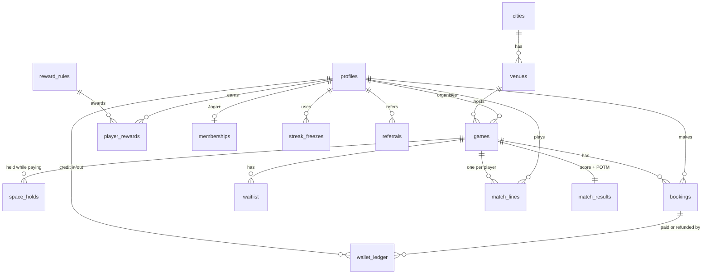

# Data model

| Table | What it holds | Written by |
|---|---|---|
| `app_settings` | Booking fee, hold length, cancellation window, referral reward, timezone | Admin |
| `cities` | Cardiff, Bristol | Admin / migration |
| `venues` | Name, city, address, surface, parking, photo | Admin |
| `profiles` | One per user: name, city, level, position, role, referral code | Sign-up trigger; player edits safe fields |
| `games` | Sport, format, venue, time, level, tags, price, capacity, venue cost, organiser | Admin |
| `space_holds` | A space held for 5 minutes while paying | `hold_space` |
| `bookings` | Who's booked, what they paid (wallet + card), cancellation and refund state | Booking functions, Stripe webhook |
| `waitlist` | Players waiting for a full game | `join_waitlist` |
| `wallet_ledger` | Append-only credit movements; balance = sum | Booking, reward and referral functions |
| `memberships` | Joga+ status and period end | RevenueCat webhook |
| `match_lines` | Per player per game: team, attended, goals, assists | `submit_match` |
| `match_results` | Score, player of the match, who submitted | `submit_match` |
| `reward_rules` | Milestones: games played, streak weeks, POTM awards, with credit amounts | Admin |
| `player_rewards` | Which milestones each player has earned (never paid twice) | `submit_match` |
| `streak_freezes` | Weeks protected by a Joga+ streak freeze | `use_streak_freeze` |
| `referrals` | Who referred whom and whether it's paid out | Sign-up trigger, `submit_match` |

## Rules worth knowing

- **Spaces taken** = confirmed bookings + holds that haven't expired.
- **Weekly streak**: at least one attended game per week (Monday to Sunday,
  UK time). A streak freeze counts as a played week.
- **Seasons** run from 1 August.
- **Refunds** return the game price to the wallet; the £1 booking fee isn't
  refunded. Free cancellation until 24 hours before kick-off; after that,
  only if someone else takes the space.
- **Rewards** are checked for every player after each result is submitted.
  Joga+ members get the `member_credit_pence` amount.
